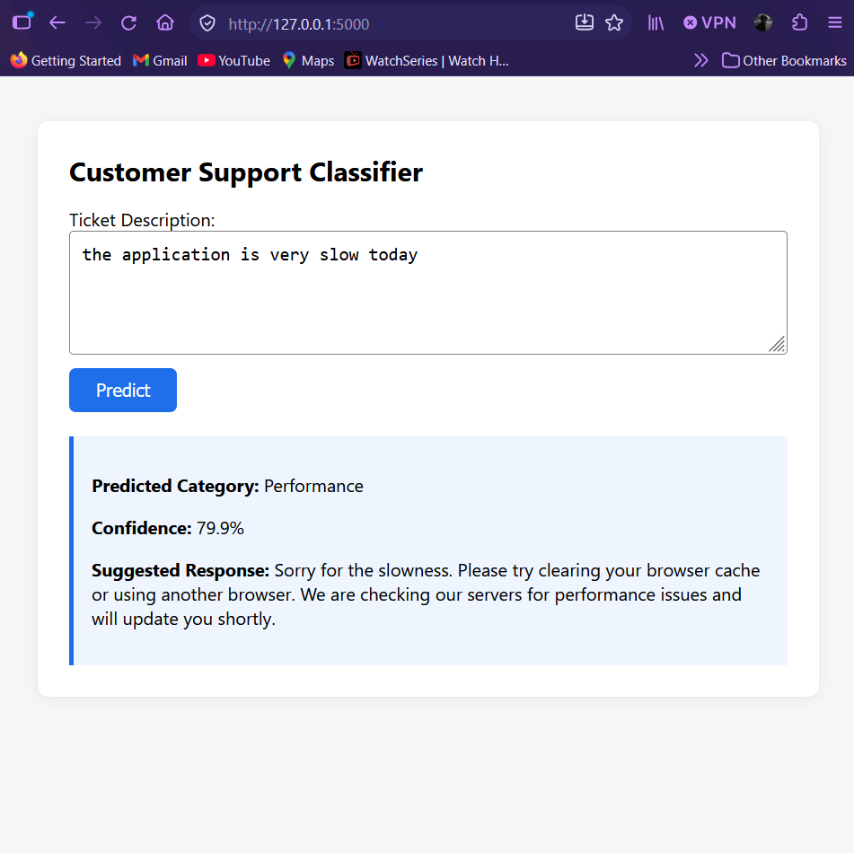
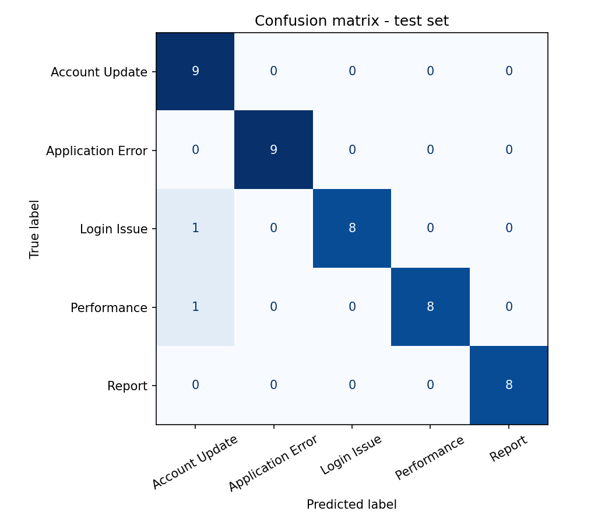
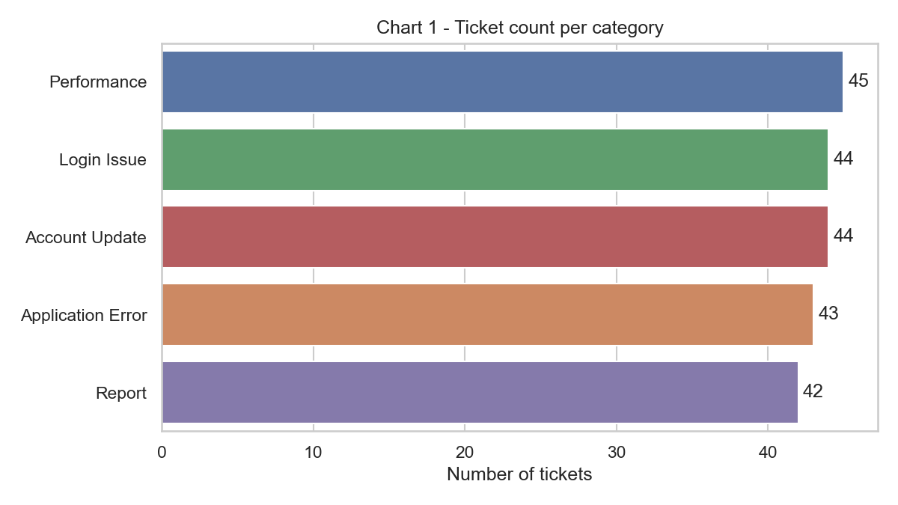

# Customer Support Ticket Classification System


**Author:** SUBHAYU GHOSHAL



## Project overview
A small end-to-end machine-learning project that reads a customer support ticket
description and predicts its **category** (Login Issue, Application Error, Report,
Account Update, Performance). It covers data cleaning, EDA, model training and
evaluation, a command-line app, a Flask web app, and a rule-based suggested reply (bonus).

## Problem statement
A company receives support requests through many channels. Manually sorting them is slow.
Given only the ticket text, predict the correct category so the ticket can be routed automatically.

## Technologies used
Python 3.10+, pandas, NumPy, scikit-learn (TF-IDF, Logistic Regression), Matplotlib, Seaborn,
joblib (model saving), Flask (web UI), ReportLab (only to build `report.pdf`).

## Dataset information
* **Self-created synthetic dataset** - no external dataset or URL is used.
* `data/generate_dataset.py` builds `data/tickets.csv` from hand-written phrase pools plus
  20 deliberately ambiguous tickets (e.g. "The login page is very slow to load").
* 226 raw rows, 5 categories. Columns: `ticket_id, ticket_description, category, priority, status`.
* A few duplicates, missing values and messy casing were injected on purpose so that the cleaning step is meaningful.
* After cleaning: 218 tickets.

## Installation
```bash
python -m venv venv
venv\Scripts\activate          # Windows   (Linux/Mac: source venv/bin/activate)
pip install -r requirements.txt
```

## How to run
Run all commands from the project root folder.

| Step | Command |
|---|---|
| (optional) regenerate dataset | `python data/generate_dataset.py` |
| Data preparation report | `python src/preprocessing.py` |
| EDA charts -> `screenshots/` | `python src/eda.py` |
| **Train + evaluate model** | `python src/train.py` |
| Run documented test cases | `python src/predict.py --demo` |
| Interactive command-line app | `python src/predict.py` |
| Web app (open http://127.0.0.1:5000) | `python src/app.py` |

## Sample input / output
```
Enter Ticket Description:
> I am unable to login because my password is not working.

Predicted Category: Login Issue
Confidence: 93.3%
Suggested Response: Please use the 'Forgot Password' option on the login page ...
```

## Results (held-out 20% test set, 44 tickets)
Accuracy 95.5%, weighted precision 96.3%, recall 95.5%, F1 95.5%.
See `report.pdf` for the confusion matrix and an honest discussion of limitations
(the data is synthetic, so real-world accuracy would be lower).

## Project structure
```
data/        tickets.csv, generate_dataset.py
src/         preprocessing.py, eda.py, train.py, predict.py, app.py, responses.py
model/       ticket_classifier.joblib, metrics.json, classification_report.txt
screenshots/ dataset, charts, confusion matrix, prediction
report.pdf   solution documentation
```

## Use of AI tools
Claude (Anthropic) was used as an assistant to scaffold the code and draft the documentation.
I reviewed, ran and understood all of the code. No API keys or external AI APIs are used in the project;
the bonus suggested replies are rule-based.

## Screenshots

